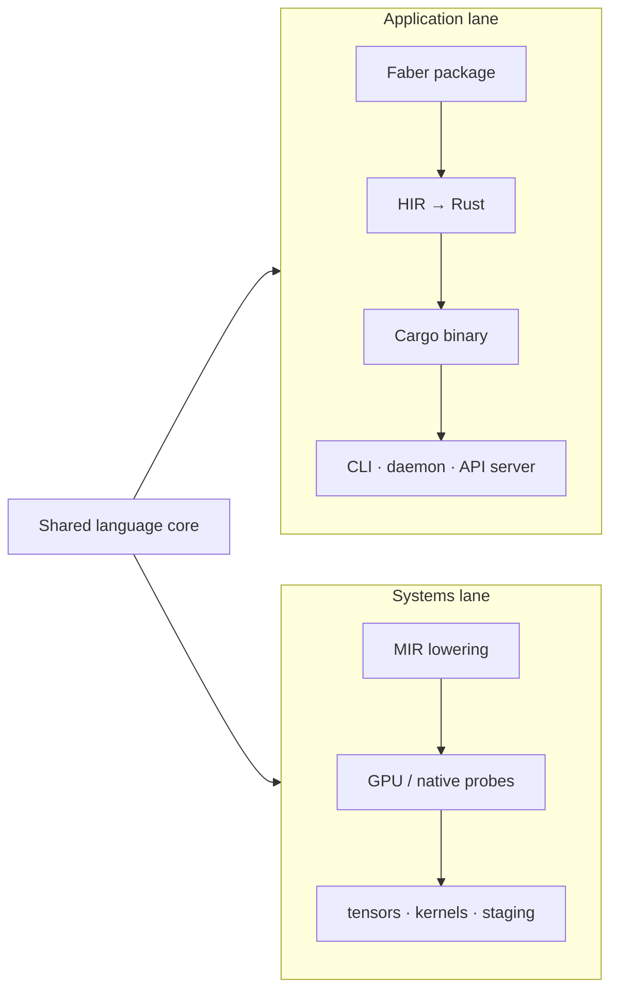

# Faber Romanus

> Faber is a package-oriented language that compiles to reviewable Rust binaries,
> with a growing Latin HAL for I/O, CLI, and data — while MIR and GPU lowering
> remain an advanced compilation track for tensors and other systems-level work.

[](https://github.com/ianzepp/faber/releases)
[](LICENSE)
[](https://github.com/ianzepp/faber/graphs/contributions)

**Status:** experimental, pre-1.0. The **application lane** — packages, CLI
tools, and native binaries — ships through **Rust** (`faber build`, `faber run`,
`faber test`). **TypeScript** and **Go** remain file-emission backends for
backend comparison and portability work; **Rust is the primary application
deliverable**.
The **systems lane** — tensors, Wasm probes, LLVM IR text, Metal and WGSL
source probes —
lowers through **MIR** and targets GPU and low-level engineering, not everyday
app delivery.

Faber's active surface is intentionally narrow: the Radix compiler library, the
Faber project/package tool, Rust runtime support, the Latin standard library,
examples, and docs. Historical bootstrap compilers, self-hosting sources, old
reference code, and old test harnesses live in the sibling archive repository;
they are useful for archaeology, not for current commands or CI.

---

## Two Compilation Lanes

Faber is one language with two compilation lanes. They share the same frontend
(parser, typechecker, exempla) but differ in what they optimize for and how you
ship the result.



### Application lane (primary product)

Write Faber packages with `faber.toml`, import the Latin HAL through flat
`norma:*` modules (`norma:solum`, `norma:json`, `norma:http`, …), and ship
**reviewable Rust** that Cargo links into a native
binary. This is the path for CLI tools, OS-level programs, API servers, and
script-style hosts. The retired `norma:hal/*` import partition is a hard error.

| Deliverable | Backend | Package `build` / `run` |
| ----------- | ------- | ----------------------- |
| **Rust binary** | HIR → `codegen/rust` | **Yes** — primary |
| TypeScript files | HIR → `codegen/ts` | No — file emission |
| Go files | HIR → `codegen/go` | No — file emission |
| Canonical Faber source | `forma` formatter | No — use `faber format` or `faber emit -t faber` |

TypeScript and Go help prove Faber's semantics across target shapes; they are
not the supported way to build and run Faber applications today.

### Systems lane (advanced compilation)

For tensors, GPU kernels, and low-level staging, Faber lowers through **MIR** to
probe backends: `wasm-text`, `llvm-text`, `metal-text`, `wgsl-text`, and the
in-process MIR stepper (`scena`). This lane is where systems-level engineering
happens — not where package `faber build` lands today.

See [Codegen Targets and HIR/MIR Split](#codegen-targets-and-hirmir-split) for
the current README summary, and use `faber targets` for live capability flags.
[`docs/design/target-capability-matrix.md`](docs/design/target-capability-matrix.md)
tracks deeper target-policy context.

---

## Contents

**Start here (landing)**

- [Two Compilation Lanes](#two-compilation-lanes) · [Why Faber](#why-faber) · [Commandments](#commandments)
- [Language Snapshot](#language-snapshot)
- [Quick Start](#quick-start) · [Package Manifest](#package-manifest)

**Project & architecture**

- [Codebase Index](#codebase-index) · [CLI Roles](#cli-roles)
- [Compilation Pipeline](#compilation-pipeline)
- [Compiler Performance](#compiler-performance)
- [Codegen Targets and HIR/MIR Split](#codegen-targets-and-hirmir-split)
- [Lowering Routes](docs/design/lowering-routes.md)
- [Exempla End-to-End Harnesses](#exempla-end-to-end-harnesses)
- [Standard Library](#standard-library)
- [Reader Locale and Diagnostics](#reader-locale-and-diagnostics)
- [Core Type Surfaces](#core-type-surfaces)
- [Capability Calls and Frames](#capability-calls-and-frames)

**Language orientation (reference)**

- [Language Orientation](#language-orientation)
- [Return and Error Channels](#return-and-error-channels)
- [Runtime binding (`←`) vs structural definition (`=`)](#runtime-binding-vs-structural-definition)
- [String and Template Literals](#string-and-template-literals)
- [Inline JSON (`valor`)](#inline-json-valor)
- [String-template application (`textus`)](#string-template-application-textus)
- [Glyphs and Words](#glyphs-and-words)
- [Nullability and Optionality](#nullability-and-optionality)
- [Conversion and Construction](#conversion-and-construction)

**More**

- [Website / Documentation Site](#website--documentation-site)
- [Archive Note](#archive-note) · [License](#license)

---

## Why Faber

Faber is a **readable semantic staging language**. You write program intent in a
small, regular source language, then lower it through one of two lanes: the
**application lane** (HIR → Rust packages and native binaries) or the **systems
lane** (MIR → GPU and low-level probes). Faber's own grammar is the center;
target backends exist to ship, test, and inspect that source.

The guiding question for Faber source:

> Can a reader see the semantic role of every construct before knowing the
> target backend?

Faber stands on three deliberate signals that work together:

- **Type-first declarations** — shape reads toward binding: `textus nomen`, not
  `nomen: textus`.
- **Latin behavioral words** — declarations, statements, lifecycle, and intent:
  `functio`, `genus`, `fixum`, `redde`, `si`.
- **Structural glyphs** — value flow, type flow, and structural joints: `←`,
  `→`, `∴`, `≡`, `∪`.

The net effect: source with stable grammatical shape before it lowers to any
backend. Its value is strongest when the source needs to be reviewed,
transformed, and lowered without losing the reader's sense of intent.

### Commandments

These are the rules that make Faber feel like Faber. Syntax can evolve, but
changes should preserve these laws.

1. **Types before names.** Declarations read from shape to binding: `textus nomen`, `numerus aetas`, `functio salve(textus name) → textus`.
2. **Mechanical over magical.** The same construct should mean the same thing everywhere. If a reader needs distant context to know what a symbol does, the syntax is suspect.
3. **Glyphs carry structure.** Use glyphs for operators, control-flow joints, and value-flow edges: `←`, `→`, `⇥`, `∴`, `≡`, `∪`.
4. **Latin carries behavior.** Use Latin words for declarations, statements, lifecycle, and behavioral intent: `functio`, `genus`, `fixum`, `varia`, `redde`, `cape`.
5. **Conjugation carries time and flow.** When the same root logic can run synchronously, asynchronously, or as a generator, the conjugated form should carry that execution mode.
6. **One sign, one job.** A glyph or keyword may have exact aliases, but it should not carry unrelated meanings. Aliases must point back to one canonical concept.
7. **Runtime flow is explicit.** Runtime binding, reassignment, and mutation use `←`; structural definition uses `=`.
8. **Absence is typed.** Nullable value types are written as unions, such as `T ∪ nihil`; optional declaration slots use post-name markers such as `sponte`.
9. **The compiler does not guess to hide missing information.** Missing type information is an analysis problem to fix upstream, not a codegen detail to paper over.

## Language Snapshot

Faber is type-first and glyph-forward:

```fab
functio divide(numerus a, numerus b) → numerus ∪ nihil {
    si b ≡ 0 ∴ redde nihil
    redde a / b
}

functio quotient(numerus a, numerus b) → numerus ⇥ textus {
    si b ≡ 0 ∴ iace "division by zero"
    redde a / b
}

genus Point {
    numerus x
    numerus y
}

incipit {
    fixum _ p ← Point {
        x = 10,
        y = 20
    }

    nota "Salve, §"(p.x)
}
```

The fastest way to recognize Faber:

- Types come before names: `textus nomen`, not `nomen: textus`.
- Runtime binding and reassignment use `←`; `=` is for structural field shape only.
- Function returns use `→`.
- Recoverable alternate exits use `⇥`; `iace` throws on that channel and
  `fac` / `cape` catches it.
- Compact branch bodies use `∴` or accepted alias `ergo`.
- Nullable values use `T ∪ nihil`.
- Latin words carry declarations, statements, lifecycle, and behavior.
- Glyphs carry value flow, type flow, and structural joints.
- Formatted `textus` uses **string-template application**: a `"…"` or `«…»`
  template with `§` holes, then `(args…)` to fill them — not target `f"…"` /
  `format!` in source. Captured payloads use `` `…` `` → `forma` (see
  [`EBNF.md`](EBNF.md)).

Use [`EBNF.md`](EBNF.md) as the formal grammar and spec-commentary source. Use
`faber explain <term>` for the disk-backed reference pack sourced from
[`crates/exempla/corpus`](crates/exempla/corpus).

## Quick Start

Install the released CLI from the Homebrew tap:

```bash
brew install ianzepp/tap/faber
faber --version
```

> **Naming note:** the `faber` crate name on crates.io is a *different* project.
> This project ships via the Homebrew tap above or by building from source.

From a checkout, the fastest path to "it works":

```bash
./scripta/ci                                           # alias for ./scripta/release --dry-run (release validation gate)
cargo run -p faber-cli -- check crates/exempla/corpus/incipit/salve-munde.fab
cargo run -p faber-cli -- build crates/exempla/corpus/incipit/salve-munde.fab
cargo run -p faber-cli -- explain ≡                         # glyph reference, disk-backed
cargo run -p faber-cli -- targets                           # live backend capability flags
```

The full command surface lives in [CLI Roles](#cli-roles); the CI wrapper expands
to `cargo fmt --all -- --check`, `cargo test --all`, `./scripta/check-exempla-pack`,
`./scripta/check-markers`, `cargo clippy --all-targets --all-features -- -D warnings`,
and the two release builds (`faber-cli`, `radix`).

## Package Manifest

Faber packages are the **application lane** unit of delivery. A `faber.toml`
manifest describes project metadata and Rust build configuration:

```toml
[package]
name = "salve"
version = "0.1.0"
edition = "2026"

[paths]
source = "src"
entry = "main.fab"

[build]
target = "rust"
kind = "bin"
```

Run `cargo run -p faber-cli -- init hello` to create a starter package. The
disk-backed reference pack covers the current package and test contracts:

```bash
cargo run -p faber-cli -- explain manifest
cargo run -p faber-cli -- explain proba
cargo run -p faber-cli -- explain probandum
```

## Codebase Index

| Area | Path | Use When |
| ---- | ---- | -------- |
| Workspace manifest | [`Cargo.toml`](Cargo.toml) | You need the active Cargo workspace members. |
| User tool | [`crates/faber-cli`](crates/faber-cli) | You are changing package/project behavior, `faber build`, `faber run`, `faber test`, `faber explain`, manifests, or generated Cargo layouts. |
| Language runtime | [`crates/faber`](crates/faber) | You are changing core runtime types (`Valor`, `Ascii`, tensors, frames) used by generated Rust and `norma`. |
| Exempla harness | [`crates/exempla`](crates/exempla) | You are changing the explain corpus layout, ignored backend e2e harnesses, or reference-pack assembly inputs. |
| Compiler | [`crates/radix`](crates/radix) | You are changing lexing, parsing, semantic analysis, HIR/MIR, diagnostics, target codegen, or the `radix` developer CLI. |
| Package store | [`crates/cista`](crates/cista) | You are changing Faber package publishing/storage. **Future** distribution mechanism: `cista.dev` will be the Faber package registry (the npm / crates.io analogue). Experimental today. |
| Rust runtime | [`crates/norma`](crates/norma) | You are changing runtime support used by generated Rust and stdlib-backed features. |
| Stdlib source | [`stdlib/norma`](stdlib/norma) | You are changing Faber stdlib declarations, HAL contracts, native Faber module bodies, or remaining target metadata. |
| Examples | [`crates/exempla/corpus`](crates/exempla/corpus) | You need small Faber programs for syntax, behavior, and backend coverage — also the disk-backed `faber explain` corpus with `+++` frontmatter and generated [`index.toml`](crates/exempla/corpus/index.toml). Treat older migration examples with care. |
| Boundary fixtures | [`examples/fixtures/exempla-boundary`](examples/fixtures/exempla-boundary) | You need proba package fixtures, harness edge cases, or negative selection examples. |
| Grammar | [`EBNF.md`](EBNF.md) | Canonical grammar and spec commentary. |
| Docs | [`docs`](docs) | You need delivery plans, release notes, and design history. |
| Website / Docs Site | [`website`](website) | You are planning future public website work from current repo truth. The subtree is currently reset to a single README. |
| Scripts | [`scripta`](scripta) | You need repo-local CI, test, lint, or helper wrappers. |
| macOS host placeholder | [`hosts/macos-arm64`](hosts/macos-arm64) | Systems-lane host runtime work for Faber-produced Wasm components on macOS arm64. |

## CLI Roles

**Faber** is the user-facing project and package tool:

- `faber check`, `faber build`, `faber targets`
- `faber explain <term>`, `faber explain --search <query>`, `faber explain --list`, `faber explain --json <term>`
- `faber init`
- `faber run`; `faber test`
- `faber format`
- Compatibility aliases: `faber lex`, `faber parse`, `faber hir`, `faber emit`, `faber cli-ir`

**Radix** is the compiler-developer tool:

- `radix lex`, `radix parse`, `radix hir`, `radix mir`, `radix emit`, `radix check`, `radix targets`, `radix cli-ir`
- Package policy lives in Faber; use `faber check <package-dir>` and `faber build` for local packages.

The full command surface from a checkout:

```bash
cargo run -p faber-cli -- targets
cargo run -p faber-cli -- explain ≡
cargo run -p faber-cli -- explain ⇥
cargo run -p faber-cli -- explain --search equality
cargo run -p faber-cli -- explain --json proba
cargo run -p faber-cli -- check crates/exempla/corpus/incipit/salve-munde.fab
cargo run -p faber-cli -- build -o /tmp/faber-out crates/exempla/corpus/incipit/salve-munde.fab
cargo run -p faber-cli -- test examples/fixtures/exempla-boundary/proba/packages/passing
cargo run -p faber-cli -- emit -t rust crates/exempla/corpus/incipit/salve-munde.fab
cargo run -p faber-cli -- format --stdout crates/exempla/corpus/incipit/salve-munde.fab
cargo run -p faber-cli -- emit -t ts crates/exempla/corpus/incipit/salve-munde.fab
cargo run -p faber-cli -- emit -t go crates/exempla/corpus/incipit/salve-munde.fab
cargo run -p faber-cli -- emit -t wasm-text crates/exempla/corpus/incipit/salve-munde.fab
cargo run -p faber-cli -- emit -t llvm-text crates/exempla/corpus/incipit/salve-munde.fab
cargo run -p faber-cli -- emit -t wgsl-text crates/exempla/corpus/vector/kernel.fab
cargo run -p faber-cli -- emit --reflection -t wgsl-text crates/exempla/corpus/vector/kernel.fab

cargo run -p radix --bin radix -- targets
cargo run -p radix --bin radix -- mir crates/exempla/corpus/incipit/salve-munde.fab
cargo run -p radix --bin radix -- emit -t rust crates/exempla/corpus/incipit/salve-munde.fab
```

> History: an earlier v0.33 shipped a single combined `faber` binary; v0.34 split
> the binaries while keeping Faber compatibility aliases for compiler-inspection
> commands. See [`docs/release`](docs/release) for details.

## Compilation Pipeline

The active compiler authority is Radix. Every lane shares the same frontend:

```text
Source (.fab)
  -> Lex
  -> Parse
  -> Collect + Resolve + Lower
  -> Typecheck + Analysis
```

After analysis, Radix chooses an emission path by lane:

```text
Application lane — HIR backends (typed HirProgram + TypeTable)
  -> Rust (primary: packages, build, run, test)
  -> Canonical Faber source through forma (format / review)
  -> TypeScript | Go (early experimental file emit)

Systems lane — MIR backends (validated MirProgram)
  -> wasm-text (.wat probe) | llvm-text (LLVM IR text probe) | metal-text (MSL probe) | wgsl-text (WGSL compute probe)
  -> scena stepper (in-process script execution)
```

`radix mir` prints the validated middle IR for compiler-development inspection.
**Application delivery** comes from the stable HIR-to-Rust backend in
`crates/radix/src/codegen/rust/` (`faber build` → Cargo → native binary). The
**systems lane** is where tensors, Wasm, LLVM text, Metal/WGSL source probes, and
GPU launch integration grow — behind MIR, not through the package build path.

For the full route vocabulary, including the AIR transform detour entered by
`@ radix lane "air"`, see [`docs/design/lowering-routes.md`](docs/design/lowering-routes.md).

## Compiler Performance

Radix's frontend scales roughly linearly with source size at ~16 MB/s, ~60 ns
per byte, in-process and single-threaded. `cargo run --release -p radix
--example bench_compile` runs the canonical sweep; representative medians
(release build, target=rust, full pipeline including codegen):

| program size | source | median compile |
| ------------ | ------ | -------------- |
| 100 functions / ~650 lines | ~10 KB | ~0.6 ms |
| 500 functions / ~3.3K lines | ~52 KB | ~3 ms |
| 1,000 functions / ~6.5K lines | ~105 KB | ~6 ms |
| 5,000 functions / ~32K lines | ~530 KB | ~37 ms |

The largest real example today is ~140 lines, ~10x below the in-process noise
floor and ~100–200x below anything a human would notice. Body weight (rebind
statements per function) scales the same way, confirming no superlinear step at
these sizes.

The in-process scripting path (`scena`, exposed via `radix::mir::run_source`)
runs the same cheap frontend, then lowers to MIR and steps it directly — it
**never** invokes `rustc` or spawns a process. Its latency decomposes as: the
same linear compile cost above, plus stepper time proportional to what the
script actually executes (independent of source size). For small scripts the
stepper is a rounding error; if a script ever feels slow, profile the stepper or
the `Host`, not the compiler.

### Backend and linking (Rust target)

The frontend cost above is a rounding error next to the backend. For the Rust
target, `faber build` emits a Rust crate and hands it to `cargo`, so the
user-perceived build time is dominated by Cargo/rustc, not by Faber.

Faber's dependency model is designed so the heavy parts compile **once and are
reused**, not rebuilt per program. Every generated crate declares the same path
dependencies:

```text
your program
   └── norma  (crates/norma, Rust runtime backing the stdlib)
         └── faber  (crates/faber, core language runtime)
```

`faber build` writes generated code under `<package>/target/faber/` and invokes
`cargo build --target-dir <package>/target/` (see `BuildLayout` in
`crates/faber-cli/src/package.rs`). Because that target directory is **reused
across builds**, Cargo's incremental compilation caches the compiled `faber` and
`norma` crates as `.rlib` artifacts and skips them on subsequent builds.

What this means in practice:

| You change | `faber` crate | `norma` crate | your program |
| ---------- | ------------- | ------------- | ------------ |
| your program source | cached | cached | recompiles |
| `stdlib/norma/*.fab` (Faber source) | cached | cached | recompiles |
| `crates/norma/src/*.rs` (Rust HAL) | cached | recompiles once | recompiles |
| `crates/faber/src/*.rs` (core runtime) | recompiles once | recompiles (cascade) | recompiles |

Two consequences:

- Changing a Faber-language library in `stdlib/norma/*.fab` does **not**
  recompile the core `faber` or `norma` Rust crates — those `.fab` files are
  compiled by Faber at build time and folded into your program's generated code,
  not into the Rust runtime crates.
- Each recompile above happens **once per reused target directory**, then is
  shared by every program built into it. You are never paying a cold `faber` +
  `norma` compile per program on the second build.

The trap to avoid (one the exempla harness had to fix) is building each program
into its own fresh `target/`. That defeats Cargo's incremental cache and makes
the `faber` runtime recompile once per program instead of once per target dir.
Any wrapper, harness, or CI flow that invokes `cargo build` should reuse a shared
`--target-dir` to keep the cached `.rlib`s warm.

Representative backend costs, measured against the exempla corpus (release build
is not required; these are cold-vs-warm dep compiles):

| phase | cost |
| ----- | ---- |
| cold `faber` dep compile (once per target dir) | ~2.8 s |
| cold `tokio` dep compile (only when needed) | ~2.3 s |
| warm per-program build (cached deps) | ~30-110 ms |
| per-program Cargo invocation overhead (spawn + fingerprint) | ~400 ms |

The remaining per-program floor is Cargo's invocation overhead, not compilation.
Systems-lane tracks (`llvm-codegen`, `wasm-codegen`) explore removing that floor
by emitting target code directly — a separate concern from application-lane
package delivery through Rust + Cargo.

## Codegen Targets and HIR/MIR Split

See `faber targets` or `radix targets` for live backend capability flags. On the
**application lane**, package builds from `faber.toml` are **Rust-only**; Go and
TypeScript support file emission but not package compilation. Canonical Faber
source output is formatter-owned (`faber format`, or `faber emit -t faber`) and
is not listed by `faber targets` as a backend. On the **systems lane**, MIR
targets are probes and staging — not package deliverables.

| Lane | Target | CLI | Backend path | Package build | Notes |
| ---- | ------ | --- | ------------ | ------------- | ----- |
| Application | `rust` | `-t rust` | HIR → `codegen/rust` | **Yes** | **Primary deliverable** — `rustc` + Cargo via `faber run` / `faber test`. |
| Application | `ts` | `-t ts` | HIR → `codegen/ts` | No | File emission supported; package compilation is not yet supported. |
| Application | `go` | `-t go` | HIR → `codegen/go` | No | File emission supported; package compilation is not yet supported. |
| Systems | `wasm` | `-t wasm` | MIR → wasm encoder | No | Experimental Wasm binary emit; run through an external host. |
| Systems | `wasm-text` | `-t wasm-text` (alias `wat`) | MIR → `mir/wasm_text` | No | WAT probe with `faber_diag` imports. |
| Systems | `llvm-text` | `-t llvm-text` | MIR → `mir/llvm_text` | No | LLVM IR text probe; staging for native/GPU lowering, not app delivery. |
| Systems | `metal-text` | `-t metal-text` | MIR → `mir/metal_text` | No | Metal Shading Language source probe for local GPU work. |
| Systems | `wgsl-text` | `-t wgsl-text` (alias `wgsl`) | MIR → `mir/wgsl_text` | No | WGSL compute-shader source probe; `faber emit --reflection` prints WebGPU sidecar JSON. |
| Systems | `sexp` | `-t sexp` | MIR → Racket s-expression | No | Experimental Racket s-expression probe. |

**Application lane (HIR)** maps the typed high-level IR directly to target
source. This is where packages, the Latin HAL, CLI generation, and reviewable
Rust binaries live. Go and TypeScript share the HIR path for file emission, but
Rust is what `faber build` ships for packages.

**Systems lane (MIR)** lowers the analyzed unit to validated MIR first, then
emits probe artifacts for tensors, GPU kernels, and low-level staging. This
keeps Wasm, LLVM, and Metal experiments behind one semantic lowering layer
instead of duplicating control-flow and runtime policy in every HIR backend.

**AIR-lane functions** are a function-level detour on MIR-backed targets:
`@ radix lane "air"` routes an accepted pure function through HIR → AIR → MIR,
then rejoins the ordinary MIR backend. AIR is for pure transform work such as
future tensor fusion and autodiff; it is not a target backend.

## Exempla End-to-End Harnesses

The compiler ships slow, explicit exempla harnesses under
`crates/exempla/src/exempla_e2e/` and `crates/exempla/tests/e2e_harness.rs`.
They are `#[ignore]` in normal `cargo test` runs; invoke them when validating a
compilation lane. Corpus-scale harnesses (Rust, Go, TS, Wasm, LLVM, round-trip,
sexp, rust-canonical) use the `e2e_harness` integration binary; MIR/script/GPU
matrix harnesses stay on the lib test binary:

```bash
cargo test -p exempla --test e2e_harness exempla_rust_e2e -- --ignored --nocapture
cargo test -p exempla --test e2e_harness exempla_rust_canonical -- --ignored --nocapture
cargo test -p exempla --test e2e_harness exempla_ts_e2e -- --ignored --nocapture
cargo test -p exempla --test e2e_harness exempla_go_e2e -- --ignored --nocapture
cargo test -p exempla --test e2e_harness exempla_wasm_e2e -- --ignored --nocapture
cargo test -p exempla --test e2e_harness exempla_faber_roundtrip_e2e -- --ignored --nocapture
cargo test -p exempla --lib exempla_mir_e2e -- --ignored --nocapture
cargo test -p exempla --lib mir_target_coverage_matrix -- --ignored --nocapture
```

Default workspace tests: `./scripta/test`. Release-level gates add parity and the
MIR matrix via `./scripta/test --full`.

Each harness walks every `.fab` file under `crates/exempla/corpus/` and prints a
pass/fail or tier report to stdout. Run the commands above for live numbers; the
README does not track counts because the corpus and backends move continuously.

| Harness | What it exercises |
| ------- | ----------------- |
| `exempla_rust_e2e` | HIR → Rust, `rustc`, format hooks, stdout `.expected` checks |
| `exempla_rust_canonical` | HIR → Rust, rustfmt/clippy canonicality floors without running binaries |
| `exempla_go_e2e` | HIR → Go, `gofmt`, best-effort `go vet`, `go run`, stdout checks |
| `exempla_ts_e2e` | HIR → TS emit, optional format/lint, `tsc`, `node` run tiers |
| `exempla_wasm_e2e` | MIR → `.wat`, `wasm-tools validate`, tier floors in `wasm_expectations.rs` |
| `exempla_faber_roundtrip_e2e` | `forma` canonical Faber output and re-parse stability |

Toolchain notes:

- **Go** requires `go` on `PATH`.
- **Rust canonical** requires `rustfmt` and `cargo clippy` on `PATH`.
- **TypeScript** benefits from `tsc` and `node`; formatter/linter tiers skip without
  `prettier`/`deno` or `biome`/`eslint`.
- **Wasm** uses `wasm-tools validate` for compile-valid tiers.

The TS harness is informational (tier report, no hard assert). Rust, Rust
canonical, Go, and Wasm harnesses enforce expected-failure metadata or tier
floors. When the exempla corpus grows, update `expected_failures`, Rust
canonical floor constants, and `WASM_EXPECTED_TIER_FLOORS` in
`crates/exempla/src/exempla_e2e/` or those harnesses will fail until metadata catches up.

## Standard Library

On the **application lane**, Faber programs import the Latin HAL and data
modules through flat `norma:*` paths — filesystem (`norma:solum`,
`norma:solum/path` for pure pathname ops), HTTP (`norma:http`), processes
(`norma:processus`), JSON/TOML/YAML (`norma:json`, …), and more. Tensor and
numeric surfaces are now core language/runtime features; `norma:tensor` adds
importable helper recipes over the compiler-owned tensor primitives. Codec
navigation (`norma:valor`) is separate from wire floors (`norma:json/solve`,
`norma:json/pange`).

Stdlib declarations live in [`stdlib/norma`](stdlib/norma); architectural
detail lives in [`stdlib/norma/README.md`](stdlib/norma/README.md). The Rust
crate [`crates/norma`](crates/norma) is a historical/migration backing reference,
not the stdlib itself — direct Rust linkage (`@ externa`, `@ subsidia`) has been
retired from `stdlib/norma/**/*.fab` source. Native Faber bodies are the default
implementation tier; effectful modules open `ad` route conversations, and
behavior not yet expressible natively carries an explicit `mori` deferred body
tracked in the Stage 2 route ledger:

```fab
functio leget(textus via) → textus {
    redde ad 'solum:leget' (via) ↦ textus
}
```

Compiler-owned intrinsics cover core collection and scalar surfaces; stdlib
source should not be treated as a complete annotation-to-target mapping table.
`@ verte` remains a language-level annotation for narrow per-target emit
metadata (used in exempla), but it is not the general story for how the current
standard library is implemented.

## Reader Locale and Diagnostics

Reader-language packs are a first-class compiler surface. A pack maps Faber
keywords, primitive type spellings, and **code-first diagnostics** into a reader
locale. Installed packs live under `stdlib/reader/<locale>/pack.toml`; seven ship
today: `la`, `ar`, `hi`, `vi`, `th-TH`, `zh-Hans`, `zh-Hant`.

`la` is the default reader surface — Latin Faber keywords and canonical type
spellings mapped to themselves, with English diagnostic message templates.
Other locales are not Latin-prose diagnostics; they remap keyword/type spelling
and render the same structured diagnostics in the reader language.

Diagnostics are **structured facts before prose**: each carries a stable code
(`LEX###`, `READER###`, `PARSE###`, `SEM###`, `WARN###`) and named arguments;
the pack owns the rendered template text. A pack carries a `[keywords]`,
`[types]`, `[diagnostics.*]`, and `[llm]` table — the last holds a
`system_prompt_snippet` and exemplars for LLM codegen.

Select a locale with the `--reader-locale <locale>` flag (overrides the
manifest) or the `faber.toml` `[reader]` table. The pack is then resolved in
order: a manifest-declared `pack` path, a package-local
`reader/<locale>.toml` override, or the installed pack:

```toml
[reader]
locale = "zh-Hans"
```

The compiler validates installed packs against the generated Latin scaffold.
Run `./scripta/check-reader-pack-completeness` after changing keyword/type
spellings or diagnostic codes. Runtime API: `radix::reader_locale`
(`ReaderLocalePack`, `validate_reader_pack`, `latin_reader_pack`).

## Core Type Surfaces

Faber's current core type surface is broader than the early language sketches.
Use [`EBNF.md`](EBNF.md) for exact grammar, and use runnable exempla under
[`crates/exempla/corpus`](crates/exempla/corpus) for the checked reference.

### Type and Size Generics

Functions, type aliases, `genus`, and `implendum` declarations accept
type parameters with `<T>` syntax. Size/index parameters use `magnitudo` in
declaration parameter lists.

```fab
functio identitas<T>(T valor) → T {
    redde valor
}

functio primum<T>(lista<T> res) → T ∪ nihil {
    redde res.primus()
}
```

Explicit call-site type arguments are supported where inference is not enough:

```fab
fixum _ value ← identitas<numerus>(7)
fixum _ maybe ← primum<numerus>([value])
```

See [`crates/exempla/corpus/generic`](crates/exempla/corpus/generic) and
[`crates/exempla/corpus/functio/generic-call-type-args.fab`](crates/exempla/corpus/functio/generic-call-type-args.fab).

### Numeric Widths

`numerus` and `fractus` have default widths (`i64` and `f64`) and explicit width
forms:

```fab
fixum numerus<i32> narrow ← 7 ∷ numerus<i32>
fixum numerus<u64> wide ← 255 ∷ numerus<u64>
fixum fractus<f32> single ← 1.5 ∷ fractus<f32>
```

Width sugar is available in type position: `i8` … `u64`, `f16`, `f32`, and `f64` are
equivalent to `numerus<W>` / `fractus<W>`. General Faber code usually prefers
long form for readability; numeric and tensor-heavy modules may use sugar.

See [`crates/exempla/corpus/typi/sized-numerus.fab`](crates/exempla/corpus/typi/sized-numerus.fab)
and [`docs/design/numeric-type-sugar.md`](docs/design/numeric-type-sugar.md).

### Tensors And Sparsa

Faber's fixed-shape numeric buffers are a small family rather than one storage
policy. `tensor<T, Figura>` is the dense form: every coordinate in the static
shape has a stored value. `sparsa<T, Figura>` is the sparse sibling: the
mathematical shape is the same, but only non-zero/default entries are stored and
omitted coordinates read as zero/default.

Both forms use the same `Figura` discipline. `_` is an inferred shape, `[]` is
rank-0, `[N]` is a vector-shaped rank-1 buffer, and `[M, N]` is a rank-2 buffer.
Both require numeric element types (`numerus`, `fractus`, or sized numeric
spellings such as `f32`, `i64`, and `u32`). `sparsa` is not a subtype of
`tensor`; it is a different representation of the same kind of fixed-shape
numeric data.

```fab
fixum tensor<fractus<f32>, []> scalar ← vacua
fixum tensor<numerus, [4]> vector ← [1, 2, 3, 4] ↦ tensor<numerus, [4]>
fixum numerus ∪ nihil first ← vector[0]
```

Dense `tensor` is the default when most coordinates carry data or when dense
algorithms are the point: flattening, indexing, elementwise arithmetic, matrix
multiplication, reductions, and shape-changing construction. `vacua` is legal
for `tensor<T, []>` and creates a rank-0 tensor; larger dense tensors are built
from data or explicit factory methods so the element count is unambiguous.

Sparse `sparsa` is the default when the full shape matters but most coordinates
are zero/default. `vacua` is legal for any sparse shape and creates an all-zero
sparse tensor with no stored entries. `accipe` returns the stored value or
zero/default when the coordinate is absent. `ponde(indices, zero)` removes a
stored entry.

```fab
incipit {
    varia sparsa<fractus<f32>, [2, 3]> sparse ← vacua

    sparse.ponde([0, 1], 4.0)
    sparse.ponde([1, 2], 9.0)
    sparse.ponde([1, 2], 0.0)

    nota sparse.accipe([0, 1]), sparse.accipe([1, 2]), sparse.nonnihil()
}
```

Numeric/tensor-primary code can use sugar:

```fab
fixum lista<f32> flat ← [1.0, 2.0, 3.0, 4.0]
fixum tf32[] seed ← vacua

fixum tf32[2, 2] grid ← seed.strue(flat, [2, 2])
fixum sf32[2, 2] sparseGrid ← grid ↦ sf32[2, 2]
fixum tf32[2, 2] denseGrid ← sparseGrid ↦ tf32[2, 2]
```

The `t` and `s` sugar families mirror each other: `tf32[2, 3]` means
`tensor<f32, [2, 3]>`, while `sf32[2, 3]` means `sparsa<f32, [2, 3]>`.
Use long-form `tensor<T, Figura>` and `sparsa<T, Figura>` in general prose and
mixed-domain code; use width sugar in numeric-heavy modules where it improves
scanability.

`↦` converts between dense and sparse only when the element type and shape are
the same. Dense-to-sparse drops exact zero/default values. Sparse-to-dense fills
absent coordinates with zero/default.

```fab
incipit {
    fixum tf32[2, 2] dense ← [[1.0, 0.0], [0.0, 2.0]] ↦ tf32[2, 2]
    fixum sf32[2, 2] sparse ← dense ↦ sf32[2, 2]
    fixum tf32[2, 2] roundtrip ← sparse ↦ tf32[2, 2]

    nota sparse.nonnihil(), roundtrip.longitudo()
}
```

Dense tensor receiver intrinsics cover shape and indexing (`forma`, `accipe`,
`ponde`, `crea`, `structa`) plus arithmetic families such as elementwise
arithmetic, matrix multiplication, and reductions. Sparse receiver intrinsics
cover shape, `accipe`, `ponde`, `nonnihil`, and `densata`. `norma:tensor`
provides importable bridge helpers over the same compiler-owned tensor surface.

See [`crates/exempla/corpus/tensor`](crates/exempla/corpus/tensor),
[`crates/exempla/corpus/sparsa`](crates/exempla/corpus/sparsa),
[`docs/design/tensor-intrinsics.md`](docs/design/tensor-intrinsics.md), and
[`docs/stdlib/tensor-methods.md`](docs/stdlib/tensor-methods.md).

### GPU Core Types

The systems lane also recognizes GPU-facing register and storage facts that are
not package-execution types yet. `f16` / `fractus<f16>` is a semantic and MIR
half-width marker. `matrix<T, [R, C]>` is a register-class value type with
exactly two static dimensions; it is not a rank-2 `tensor<T, [R, C]>` alias.
`atomic<T>` is a storage-sensitive cell type for `i32` and `u32` elements, and
values are accessed only through atomic receiver methods such as `load`,
`store`, `exchange`, and `compare_exchange`.

```fab
functio half(f16 x) → f16 {
    redde x
}

functio add(matrix<f32, [2, 2]> a, matrix<f32, [2, 2]> b) → matrix<f32, [2, 2]> {
    redde a.addita(b)
}

functio swap(atomic<i32> cell, i32 value) → i32 {
    redde cell.exchange(value)
}
```

These types are intentionally target-gated: package and probe targets that lack
a real carrier, backend spelling, storage ABI, or reflection contract fail
closed instead of erasing the type fact.
Use [`docs/design/target-capability-matrix.md`](docs/design/target-capability-matrix.md)
for the current target posture and
[`crates/exempla/corpus/gpu-core-types`](crates/exempla/corpus/gpu-core-types)
for indexed positive and negative examples.

## Return and Error Channels

Faber separates three related ideas that many languages collapse into one
shape:

- `→ T` declares the normal success return channel.
- `T ∪ nihil` makes absence part of the success value domain.
- `⇥ E` declares a recoverable alternate-exit channel for errors.

Use `redde` for normal return values:

```fab
functio porta(numerus x) → numerus {
    si x < 0 ∴ redde 0
    redde x * 2
}
```

Use `⇥` when the function can leave by an error channel instead of returning a
success value:

```fab
functio divide(numerus a, numerus b) → numerus ⇥ textus {
    si b ≡ 0 ∴ iace "division by zero"
    redde a / b
}
```

Callers can recover locally with a `fac` block and a following `cape` handler:

```fab
functio tutum(numerus a, numerus b) → numerus {
    fac {
        redde divide(a, b)
    }
    cape err {
        mone err
        redde 0
    }
}
```

A direct failable call is not an ordinary expression. In current checked Faber,
place calls to `→ T ⇥ E` functions inside an active `fac` / `cape` boundary;
declaring the caller with `⇥ E` alone does not implicitly propagate the call.

For effect-only failable functions, omit `→ T` and keep the alternate channel:

```fab
functio exigePositivum(numerus value) ⇥ textus {
    si value < 0 ∴ iace "negative value"
}
```

This is different from nullable success. A lookup that simply may not find a
value should usually return `T ∪ nihil`; a computation that failed and should
carry an error payload should use `⇥ E`.

Inline conversion recovery also uses `⇥`, but there it belongs to the `↦`
conversion expression rather than the function signature:

```fab
fixum _ n ← raw ↦ numerus ⇥ 0
```

Current status: `→`, `redde`, `⇥`, `iace`, and `fac` / `cape` are live grammar
and checker surfaces. The primary examples are
[`crates/exempla/corpus/redde/redde.fab`](crates/exempla/corpus/redde/redde.fab),
[`crates/exempla/corpus/iace/functio-fallibilis.fab`](crates/exempla/corpus/iace/functio-fallibilis.fab),
[`crates/exempla/corpus/iace/iace.fab`](crates/exempla/corpus/iace/iace.fab),
and [`crates/exempla/corpus/fac/fac-cape.fab`](crates/exempla/corpus/fac/fac-cape.fab).
Those alternate-exit examples are compile/check smoke today; Rust/Go lowering
for full `⇥`/`iace`/`cape` runtime behavior is still a backend gap.

## Capability Calls and Frames

`ad` is Faber's low-level capability-call primitive. It opens an opaque
conversation (`sermo`) with a route named by an `ascii` literal and optional
opener data lowered through `valor`:

```fab
fixum textus t ← ad 'runtime:echo' ("salve, munde") ↦ textus
```

Expression-form `ad` is the current surface. The old typed/block forms such as
`ad "route" (...) → T { ... }`, statement-level `meus`/`tuus` arms, and
statement-level `emitte` are retired.

Raw `ad` evaluates to `sermo`. Application code can materialize it with `↦ T`,
or work with live directional views:

```fab
fixum sermo s ← ad 'runtime:echo' ("salve")

fixum meus<textus> out ← s.meus<textus>()
out.da("ping")
fixum status outbound ← out.fini()

fixum tuus<textus> input ← s.tuus<textus>()
itera ex input.cursor() fixum frame {
    nota frame.data
}
fixum status inbound ← input.fini()
```

The compiler owns the language types `sermo`, `scrinium<T>`, `status`,
`meus<T>`, and `tuus<T>`. Runtime carriers and the in-process conversation API
live in [`crates/faber`](crates/faber). The host proof in
[`hosts/macos-arm64`](hosts/macos-arm64) routes frame-shaped syscalls such as
`host:echo` through an in-process kernel; it is the first concrete gateway shape
for future host-provided capabilities.

See [`crates/exempla/corpus/ad`](crates/exempla/corpus/ad),
[`docs/design/frame-stream-types.md`](docs/design/frame-stream-types.md),
[`docs/factory/frame-gateway/`](docs/factory/frame-gateway/),
and [`hosts/macos-arm64/README.md`](hosts/macos-arm64/README.md).

## Language Orientation

This section is a practical orientation to Faber source. It occasionally uses
other languages as contrast, but Faber's grammar is the authority; it is not a
variant spelling of another language.

Faber is a small source language that uses type-first declarations, Latin
behavioral words, and structural glyphs to make program intent easy to scan and
hard to confuse before it lowers to a target backend.

### How Faber Feels

Faber feels declarative, narrated, and review-oriented.

The lines below can look identical in some fonts because `->` (two ASCII
characters) and `→` (one return glyph) are easy to confuse. Faber is not “the
same function with a prettier arrow.” The whole surface is ordered and marked
differently.

This target-shaped sketch is **not** Faber — it mixes familiar backend habits
(name-after-colon types, ASCII `->`, `?`, `if`/`return`, `==`):

```text
# UNSUPPORTED FABER: target-shaped pseudo-code for contrast only.
# Do not copy this syntax.
functio divide(a: numerus, b: numerus) -> numerus? {
    if (b == 0) return null
    return a / b
}
```

```fab
# SUPPORTED FABER: type-first params, glyph return, nullable union, Latin body.
functio divide(numerus a, numerus b) → numerus ∪ nihil {
    si b ≡ 0 ∴ redde nihil
    redde a / b
}
```

The Faber shape for the same idea — types before names, Latin control words, and
structural glyphs — is the `divide` example shown in the
[Language Snapshot](#language-snapshot) above.

| Habit readers often carry over | Not Faber | Faber |
| ------------------------------ | --------- | ----- |
| Parameter and return types | `a: numerus`, `-> numerus?` | `numerus a`, `→ numerus ∪ nihil` |
| Absence / nullability | `?`, `Option<…>`, `null` | `T ∪ nihil`, `nihil` |
| Branch + return | `if (…) return …` | `si … ∴ redde …` |
| Equality | `==` | `≡` |
| Return keyword | `return` | `redde` |

Local binding is not `let name: Type = value`; it is a declaration role, a type,
a name, and runtime binding:

```fab
fixum numerus count ← 0
varia textus label ← "ready"
```

If the initializer determines the type, use `_`:

```fab
fixum _ names ← ["Marcus", "Julia"]
```

For chains of inferred immutables, `sit` compresses the spelling:

```fab
sit salve ← "Salve"
sit nomen ← "Marcus"
```

`sit nomen ← expr` is sugar for `fixum _ nomen ← expr`. When the value is not
ready at the declaration site, omit the initializer and assign exactly once
later — `fixum` is write-once in both shapes:

```fab
fixum numerus factor
si compact {
    factor ← 10
}
secus {
    factor ← 100
}

sit label
label ← "deferred"
```

`sit label` is sugar for `fixum _ label`. The definite-assignment pass rejects
reads before that single assignment and any second assignment. See
`crates/exempla/corpus/fixum/fixum.fab` and `crates/exempla/corpus/sit/sit.fab`.

Declarations read from semantic shape toward binding name. For the full `←` /
`=` split (Faber does **not** use `=` for runtime assignment), see
[Runtime binding vs structural definition](#runtime-binding-vs-structural-definition).

### Nullable Returns

The Faber `divide` example in the [Language Snapshot](#language-snapshot)
returns `numerus ∪ nihil`: an explicit value-domain union. Nullable values are
ordinary types in Faber source, not suffix sugar.

Do not invent `numerus?`, `Option<numerus>`, or `nihil numerus`.

### Borrowing and Mutability (`de`, `in`, `ex`)

Faber marks **how a value is passed** with short prepositions on parameters (and
sometimes on types). They are meant to be easy to scan in review-oriented source;
when the target is Rust, Radix lowers them to references and moves and runs a
borrow check (`crates/radix/src/semantic/passes/borrow.rs`) before codegen.

| Faber (parameter) | Intent | Typical Rust lowering |
| ----------------- | ------ | --------------------- |
| *(none)* | Owned value at the call boundary | `T` / `String` / `Vec<…>` by value |
| `de` | Shared borrow — read, do not move or assign through | `&T` |
| `in` | Mutable borrow — caller's value may change | `&mut T` |
| `ex` | Consume — value is moved into the callee | `T` (by move) |

**Read-only borrow (`de`)** — inspect without taking ownership:

```fab
functio imprime(de textus label) → vacuum {
    nota label
}
```

```rust
fn imprime(label: &str) {
    println!("{}", label);
}
```

**Mutable borrow (`in`)** — callee may update the caller's binding:

```fab
functio duplica(in numerus value) → vacuum {
    value ← value * 2
}
```

```rust
fn duplica(value: &mut i64) {
    *value *= 2;
}
```

**Consume (`ex`)** — callee takes ownership (similar to passing a `String` by value):

```fab
functio consume(ex textus buffer) → textus {
    redde buffer
}
```

```rust
fn consume(buffer: String) -> String {
    buffer
}
```

**Owned (no preposition)** — ordinary by-value parameter; Faber still uses type-first order:

```fab
functio salve(textus nomen) → textus {
    redde "Salve, §!"(nomen)
}
```

```rust
fn salve(nomen: String) -> String {
    format!("Salve, {}!", nomen)
}
```

Borrow markers can also appear on **types** (`de textus`, `in numerus`) and combine
with optional parameters (`de numerus depth sponte` — borrowed slot that may be
absent). See [`crates/exempla/corpus/functio/sponte-vel.fab`](crates/exempla/corpus/functio/sponte-vel.fab).

**Same words, different jobs.** Faber reuses `de` and `ex` in other constructs;
do not read every `ex` as “consume”:

| Surface | Role |
| ------- | ---- |
| `de textus name` on a parameter | Shared borrow |
| `in numerus count` on a parameter | Mutable borrow |
| `ex textus buffer` on a parameter | Move / consume into callee |
| `itera ex items fixum item` | Iterate **values** (for-of shape) |
| `itera de tabula fixum key` | Iterate **keys** (for-in shape) |
| `ex source fixum x, ceteri rest` | Destructure fields into locals |
| `importa ex "path"` | Import from a module path |

Go and TypeScript backends accept the same Faber syntax today, but borrow
analysis and `&T` / `&mut T` lowering are Rust-target concerns. Faber keeps
intent explicit in source without requiring lifetime annotations in the Faber
file. Precise lifetime proof remains the generated Rust compiler's job.

### Structural Declarations

Faber declarations use stable language constructs instead of target-shaped
punctuation:

```fab
typus UserId = numerus

implendum Drawable {
    functio draw() → vacuum
}
```

Faber declarations are more uniform and less punctuation-heavy. `genus` covers
class or struct-shaped declarations; `implendum` covers interface-shaped contracts;
`discretio` covers tagged unions.

Object construction is also declarative:

```fab
genus Point {
    numerus x
    numerus y
}

fixum _ p ← Point {
    x = 10,
    y = 20
}
```

`=` defines fields inside a structural literal or declaration metadata. `←`
binds the runtime value to `p`.

### Control Flow Shape

Iteration says whether it is walking values, keys, or a range:

```fab
itera ex items fixum item {
    si item ≡ target ∴ redde item
}

itera ex items fixum item { ... }  # values
itera de table fixum key { ... }   # keys
itera ab 0‥10 fixum i { ... }     # range
```

Branch bodies use a block or a one-statement consequent introduced by `∴` or its
accepted Latin alias `ergo`:

```fab
si score ≥ 90 ∴ redde "A"
sin score ≥ 80 ∴ redde "B"
secus ∴ redde "C"
```

Prefer `∴` in canonical examples. `ergo` is accepted, but glyph-first source is
the current style for structural joints.

Guard sections group early-exit checks before a function's main body. Each
`si` clause inside `custodi` is a sequential guard that returns or throws
before the rest of the block runs:

```fab
functio divide(numerus a, numerus b) → numerus {
    custodi {
        si b ≡ 0 {
            redde 0
        }
    }

    redde a / b
}
```

`custodi` is **not** breakable in v1 — it is a guard rail, not a loop. See
[`crates/exempla/corpus/custodi/custodi.fab`](crates/exempla/corpus/custodi/custodi.fab).

### Canonical Surface

When generating or reviewing Faber, default to these forms:

```fab
fixum textus name ← "Marcus"
varia numerus count ← 0
functio greet(textus name) → textus { ... }
functio parse(textus raw) → numerus ⇥ textus { ... }
si ready ∴ redde value
si invalid ∴ iace "bad input"
fixum _ n ← raw ↦ numerus ⇥ 0
fixum _ x ← value ∷ textus
functio maybe() → textus ∪ nihil { ... }
```

Avoid these stale or non-canonical forms:

```text
# UNSUPPORTED FABER: stale or foreign forms.
# Use the canonical examples above instead.
name: textus
functio greet(name: textus): textus
textus?
Option<textus>
tempta { ... }
cape err { ... }
demum { ... }
value qua textus
value innatum textus
novum Point { x = 1 }
```

```fab
# SUPPORTED FABER: canonical equivalents.
genus Point {
    numerus x
}

functio greet(textus name) → textus {
    redde "Salve, §"(name)
}

functio maybe() → textus ∪ nihil {
    redde nihil
}

functio parse(textus raw) → numerus ⇥ textus {
    si raw ≡ "" ∴ iace "empty input"
    redde raw ↦ numerus ⇥ 0
}

incipit {
    fac {
        iace "bad input"
    }
    cape err {
        nota err
    }

    fixum _ text ← "salve" ∷ textus
    fixum _ n ← "42" ↦ numerus ⇥ 0
    fixum _ p ← Point { x = 1 }
}
```

Current error handling uses `fac` with `cape` for a local recoverable boundary:

```fab
fac {
    iace "bad input"
}
cape err {
    nota err
}
```

`tempta` and `demum` are legacy surfaces. Radix still recognizes the spellings but
rejects them with migration diagnostics; use multiline `fac` / `cape` blocks and
structured `cape`/`cura` cleanup instead.

## Runtime binding (`←`) vs structural definition (`=`)

Most languages overload `=` for both “define this field in a type/literal” and
“put a runtime value in this variable.” Faber splits those jobs:

| Glyph | Role | Use for |
| ----- | ---- | ------- |
| `←` | **Runtime flow** | Initial binding, reassignment, and mutation at execution time |
| `=` | **Structural shape** | Field names inside literals and declaration metadata — not runtime stores |

**Runtime binding** attaches a value to a name when the program runs:

```fab
fixum numerus count ← 0
varia textus label ← "ready"
count ← count + 1
```

`fixum` bindings are write-once: you may declare without an initializer and
assign exactly once later (`fixum numerus pending` then `pending ← value`), or
bind immediately (`fixum numerus count ← 0`). A second assignment to the same
`fixum` local is rejected. `varia` bindings remain freely reassignable.

In Rust terms, think `let` / reassignment / `*x = …` on a binding — but in Faber
the glyph is always `←`, not `=`.

**Structural definition** lists members inside a composite value or declaration:

```fab
genus Point {
    numerus x
    numerus y
}

fixum _ p ← Point {
    x = 10,
    y = 20,
}
```

Here `x = 10` and `y = 20` spell the **shape** of the `Point` value. The runtime
step is the outer `fixum _ p ← Point { … }`: create the value, then bind `p`.

**What not to write.** These are foreign habits, not Faber:

```text
# UNSUPPORTED FABER: runtime assignment uses ←, not =.
varia numerus count = 0          # = is not runtime assignment
fixum _ p = Point { x = 1 }     # use ← to bind the whole value
```

```fab
# SUPPORTED FABER: runtime binding uses ←; structural fields use = inside Point.
varia numerus count ← 0
fixum _ p ← Point { x = 1 }
```

Faber keeps `=` from meaning “store into this variable at runtime,” which makes
review easier: every `←` is live data flow; every `=` inside `Type { … }` is
genus field layout; bare `{ … }` is JSON `valor` (`:` syntax). Compare `∷`
(static ascription) and `↦` (runtime conversion) in
[Conversion and Construction](#conversion-and-construction) — three different
arrows, three different jobs.

## String and Template Literals

Faber uses **delimiter semantics** — each quote form means a different source
shape. They are not interchangeable synonyms. Factory delivery specs:
[`textus-literal-family`](docs/factory/textus-literal-family/goal.md),
[`ascii-type`](docs/factory/ascii-type/goal.md),
[`forma-parameterized-templates`](docs/factory/forma-parameterized-templates/goal.md),
[`inline-json-valor`](docs/factory/inline-json-valor/goal.md),
[`octeti-literal`](docs/factory/octeti-literal/goal.md),
[`regex-literal`](docs/factory/regex-literal/goal.md).

| Form | Type | Role |
| --- | --- | --- |
| `'…'` | `ascii` | fixed machine tokens; no `§`; no `(...)` |
| `"…"` | `textus` | short Unicode line strings; `(...)` renders |
| `«…»` | `textus` | block/multiline Unicode; `(...)` renders |
| `` `…` `` | `forma` | captured templates; `(...)` captures |
| `{ … }` | `valor` | compile-time JSON object |
| `\|…\|` | `octeti` | compile-time hex bytes |
| `"…" ↦ regex` | `regex` | compiled pattern from text conversion; slash-delimited regex literals are pending |
| `[ … ]` | `lista<T>` | Faber list |

`§` (U+00A7) is the template hole in the Unicode `textus`/`forma` forms only; it
cannot appear in `ascii` literals. See
[String-template application](#string-template-application-textus) for how `§`
holes are filled.

## Inline JSON (`valor`)

A bare `{ … }` is **inline JSON**: a compile-time `valor` literal, not an
anonymous Faber object. Keys are quoted JSON strings separated by `:`; values are
JSON constants (strings, numbers, booleans, `null`, nested objects, and arrays).
Trailing commas are allowed. Duplicate keys are an error.

```fab
fixum _ empty ← {}
fixum _ user ← { "name": "Marcus", "age": 30, "active": true }
fixum _ nested ← { "meta": { "version": 1 }, "tags": ["alpha", "beta"] }
```

For typed genus construction with Faber expressions, use the type name and `=`
field shape — not JSON `:` syntax:

```fab
fixum _ p ← Point { x = 10, y = 20 }
```

See `crates/exempla/corpus/destructura/literal.fab` and
[`inline-json-valor`](docs/factory/inline-json-valor/goal.md) for the full
delivery spec.

## String-template application (`textus`)

Faber formats text with **string-template application**: a `"…"` or `«…»`
literal, optional `§` placeholders inside it, then a parenthesized argument list
that supplies values in order. This is the canonical source form for rendered
`textus`; the compiler lowers it to an internal `scriptum("…", …)` call.

```fab
functio greet(textus nomen) → textus {
    redde "Salve, §!"(nomen)
}

fixum _ msg ← "Page § of §"(pagina, totum)
fixum _ block ← «status: § (§)»(code, label)
nota "Salve, §"(p.x)
```

Block `textus` uses guillemets `«…»`, not `❝…❞`. Multiline blocks prefer a
newline immediately after the opening `«`:

```fab
fixum _ sql ← «
    select id, email
    from accounts
»
```

Three details matter because the shape is unusual compared to Rust, Python, or Go:

1. **Unicode `textus` delimiters.** Line strings and templates use `"…"`. Block
   regions use `«…»`. Faber is **Unicode-first**: source is normalized (NFC) and
   string indexing is Unicode-scalar based, so templates naturally include Latin,
   glyphs, and `§`. Machine tokens (`'pg:query'`) use `ascii` when that delivery
   lands.

2. **`§` is the format hole, not a runtime value.** Inside `"…"` or `«…»`, `§`
   marks where the next argument is injected. Positional holes are written `§0`,
   `§1`, … when order must be explicit (`"status: §1 (§0)"("ok", sample_status())`).
   A trailing `!` on the hole (as in `"Salve, §!"`) selects display formatting on
   backends that distinguish it; otherwise the compiler picks a sensible default.

3. **Parentheses apply the template.** The call-like suffix `(nomen)` is not a
   function named `"Salve…"` — it is **template application**: build a `textus`
   value by substituting the arguments into the holes. Prefer this over writing
   `format!(…)` / `f"…"` / `fmt.Sprintf(…)` directly in Faber source.

**Captured templates** (`forma`) use backticks: `` `select … where id = §`(id) ``
captures template text and parameters without rendering. Use that form for bound
SQL/URL payloads; `«…»(args)` still renders and is not safe for parameter binding.

Per-file metadata (`group`, `sectio`, `[probanda]`, manifest fragments) belongs
in optional `+++` TOML frontmatter on line 1 — not in the Faber program body.
Package layout authority remains `faber.toml`. Use `faber explain §` for the
template-hole glyph and `faber explain manifest` for package manifests.

For output statements, `nota`, `vide`, and `mone` accept the same template form.
Use `faber explain scriptum` or `faber explain string` for the reference entry.

## Glyphs and Words

Faber uses glyphs where the symbol is structural. Below is the full inventory of
source glyphs the lexer recognizes. Grammar and precedence live in [`EBNF.md`](EBNF.md);
behavioral constructs use Latin keywords (listed after the glyphs).

<details>
<summary><b>Full glyph inventory</b> (click to expand)</summary>

**Value flow**

- `←` — runtime binding, reassignment, and mutation
- `→` — function return type
- `⇥` — alternate exit: error-channel type on signatures (`→ T ⇥ E`), or inline conversio recovery (`↦ T ⇥ value`)
- `∴` — compact therefore body (`si cond ∴ redde x`)

**Type shape**

- `∷` — static type ascription (compile-time cast)
- `↦` — runtime conversion (can-fail parse/coerce)
- `∪` — inline union type (`T ∪ nihil`)

**Arithmetic**

- `+` `-` `*` `/` `%`

**Comparison**

- `≡` `≠` — equality and inequality
- `<` `>` `≤` `≥` — ordering

**Logical and bitwise**

- `∧` `∨` `⊻` `¬` — and, or, xor, not
- `⇐` `⇒` — left and right bit shift

**Assignment updates**

- `←` — the only assignment operator in expressions (`count ← count + step`,
  `buf ← buf + suffix`)
- `⊕` `⊖` — postfix increment/decrement **statements** for mutable `numerus`
  places (`count ⊕`, `index ⊖`). Statement-only: no expression value, no prefix
  forms, not valid inside larger expressions. Compound-assignment glyphs
  (`⊛` `⊘` `⊜` `⊚` and expression-level `⊕`/`⊖`) were removed; see
  [`docs/release/compound-removal-postfix-incdec.md`](docs/release/compound-removal-postfix-incdec.md).

**Optional and non-null access**

- `?` `?.` `?[` `?(` — optional chaining
- `!` `!.` `![` `!(` — non-null assertion

**Ranges**

- `‥` — exclusive range endpoint
- `…` — inclusive range endpoint

**Literal delimiters and template holes**

- `'` — `ascii` literal
- `"` — line `textus` literal
- `«` `»` — block `textus` literal (guillemets)
- `` ` `` — `forma` captured template literal
- `|` — `octeti` hex literal
- `/` — division; slash-delimited regex literals are not active source syntax
- `§` — template hole inside `"…"`, `«…»`, and `` `…` ``

**Grouping and punctuation**

- `(` `)` — grouping and call
- `{` `}` — block, genus literal, or JSON `valor`
- `[` `]` — list literal and indexing
- `,` — separator
- `:` — JSON `valor` field separator inside `{ … }`
- `;` — statement separator
- `.` — member access
- `=` — structural field shape inside genus literals and declarations (not runtime
  assignment; use `←` for live flow)
- `@` — annotation marker
- `#` — line comment

</details>

Faber uses Latin words where the construct has behavioral or grammatical shape:

- `functio`, `genus`, `implendum`, `typus`, `ordo`, `discretio`.
- `fixum`, `varia`, `sit`, `redde`, `iace`, `mori`, `tacet`.
- `si`, `sin`, `secus`, `dum`, `itera`, `elige`, `discerne`.
- `fac`, `cape`, `cura`.

A good Faber source file should look like a stable grammar, not like a target
language wearing Latin labels.

## Nullability and Optionality

Faber distinguishes absence in a value from optional provision at a declaration
site.

Use `T ∪ nihil` when the value can be absent:

```fab
functio find(textus key) → numerus ∪ nihil
```

Use `sponte` after the name when a parameter or field may be omitted by the
caller or constructor:

```fab
functio connect(textus host, numerus port sponte) → vacuum

genus User {
    textus email sponte
}
```

Deferred immutable locals use `fixum` or `sit` (see
[Compared To Rust](#compared-to-rust)). Do not use `ignotum` as a nullability
escape. `ignotum` is the top-level unknown type for escape hatches and incomplete
knowledge, not "maybe null."

## Conversion and Construction

There are two important conversion operators:

```fab
fixum _ parsed ← "42" ↦ numerus
fixum _ safe ← input ↦ numerus ⇥ 0
fixum _ text ← value ∷ textus
```

Use `↦` for runtime conversion, especially parsing or coercion that may fail.
Supply inline recovery with `⇥` on conversio (`↦ T ⇥ recovery-value`).

Use `vel` only for nullish coalescing when a value is `nihil`, not for conversio
failure.

Use `∷` for explicit static type ascription. It is postfix and target-type
driven. Prefer ordinary typed construction and `vacua` where they say the same
thing more directly:

```fab
fixum lista<numerus> xs ← vacua
fixum _ p ← Point { x = 10, y = 20 }
```

`Type(...)` is not Faber construction syntax. Use `value ↦ Type` for
type-directed materialization, named library constructors for argument-taking
construction, and `Genus { field = value }` for records. For vectors, write:

```fab
fixum vf32[4] lanes ← [1.0, 2.0, 3.0, 4.0] ↦ vf32[4]
```

The old vector-only type-call spellings `vf32[4](...)` and
`vector<f32, 4>(...)` are rejected.

## Website / Documentation Site

The public Faber documentation site lives in [`website/`](website/) as part of this monorepo.

The website subtree has been reset to a single planning README. Future website
work should start from current repository truth instead of the removed stale
site contents.

See [`website/README.md`](website/README.md) for the high-level content needs,
truth-source rules, and future acceptance criteria.

## Archive Note

Historical bootstrap compilers, self-hosting sources, old reference code, and
old test harnesses are preserved in `../faber-archivum`. They are not current
main-repo commands or CI surfaces.

## License

Faber is **MIT** licensed. See [`LICENSE`](LICENSE).

*Opus perfectum est when `./scripta/ci` passes.*
